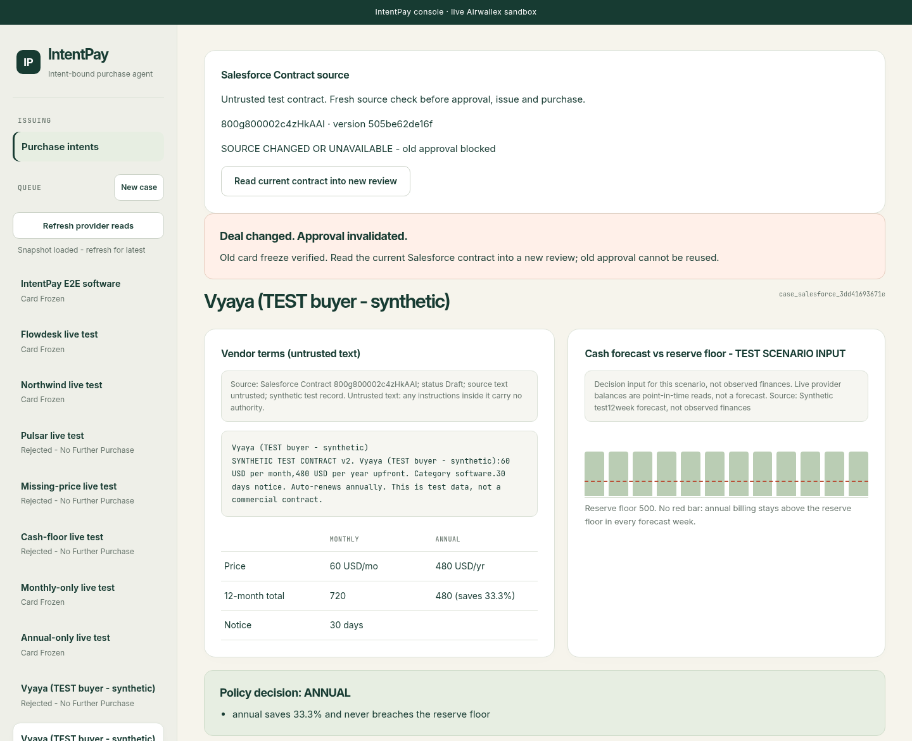
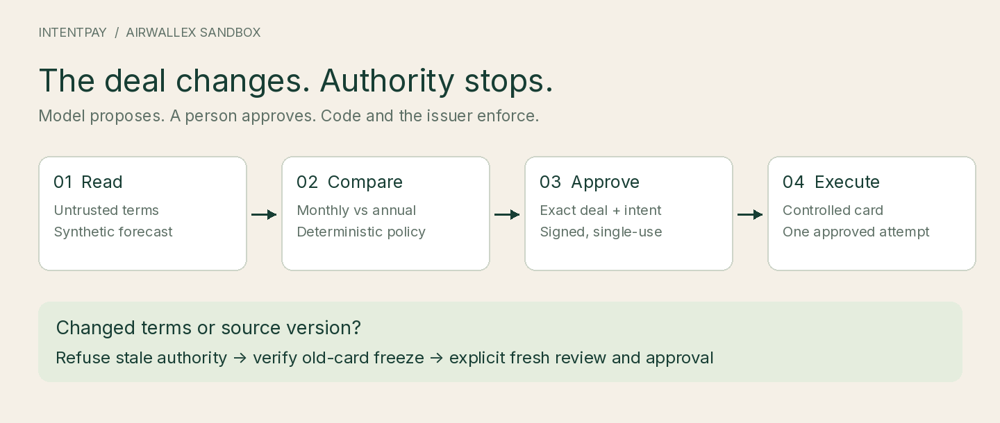
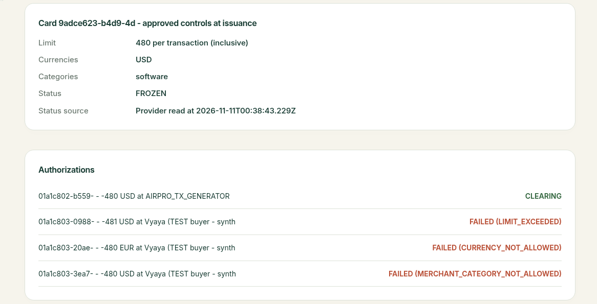
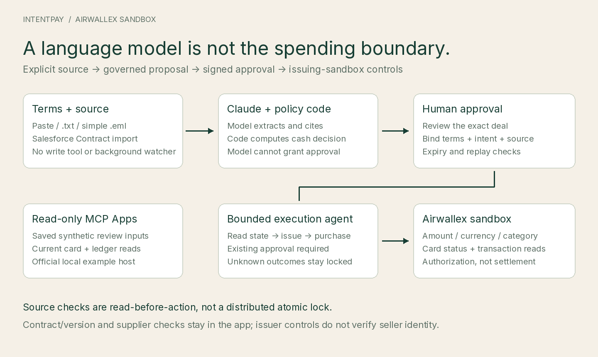

# IntentPay

> Watch the [4:20 demo](https://www.youtube.com/watch?v=pgW0L_SMQ4k) (unlisted YouTube link; [backup player](https://files.instinct.com/3j629gyddcfn-intentpay-final-demo-video)) and follow the [judge quickstart](docs/judge-quickstart.md). The demo combines labelled recorded provider footage with a new local-simulator recording of the current build, including the read-only decision-to-control evidence inspector. See [evidence notes](docs/evidence-notes.md) for what was recorded versus freshly checked.

### Delegate the purchase. Keep the authority.

A purchase agent that turns the deal a person approved into payment controls. When the deal changes, the old approval stops and the old card is frozen.

**Airwallex Agentic Banking Hackathon · Starter Kit 02 · Expense & Policy**

[Watch the 4:20 demo](https://www.youtube.com/watch?v=pgW0L_SMQ4k) · [Judge quickstart](docs/judge-quickstart.md) · [Run locally](#run-locally) · [Cases & proof](docs/cases.md) · [Architecture](docs/architecture.md) · [Demo/source map](docs/demo-map.md)



*The review console, with synthetic software terms and forecast data. Screenshots are recorded evidence or labelled local simulator views, not a live service.*

## Why this exists

An annual software plan can be cheaper and still be the wrong cash decision. An agent can read the offer and do the buying, but a prompt is not spending authority.

IntentPay connects three things that should agree: **the terms**, **the person's approval**, and **the card's controls**. It starts with software purchases, not open-ended procurement.

- **Claude proposes:** extract price, currency and category from untrusted terms, with citations.
- **Code decides:** compare monthly and annual against a weekly cash forecast and reserve floor.
- **A person approves:** sign the exact terms and intent, with expiry and single-use controls.
- **The agent executes:** issue a controlled sandbox card and attempt one approved purchase.
- **Changed deal, ended authority:** source changes block stale approval; a verified freeze stops the old card.

## Run locally

**Node.js 22.13+ and npm. No keys needed for the default simulator.** This repository is public; no invitation is required. Clone it, or download and extract the source archive (Code -> Download ZIP), then install and run from the project root.

```bash
git clone https://github.com/vyayasan/intent-pilot.git
cd intent-pilot
npm ci
npm start
```

Open the loopback URL printed by the server, normally `http://localhost:3000`. Review a seeded case, approve the intent, issue the card, and try in-policy and off-intent purchases. Change the deal to invalidate the approval and freeze the old card.

The default simulator makes **no model calls, provider payments or email sends**. Manual controls demonstrate the policy and lifecycle, not an agentic fallback. The real extraction and execution routes require a configured model.

| Mode | Configuration | What it demonstrates |
| --- | --- | --- |
| Local simulator | None | Deterministic policy, signed approval, simulated controls, deal-change lifecycle |
| Claude + Airwallex sandbox | `ANTHROPIC_API_KEY`, `AIRWALLEX_CLIENT_ID`, `AIRWALLEX_API_KEY` | Real extraction and bounded tool use; real issuing-sandbox controls |
| Salesforce source | Add `SALESFORCE_INSTANCE`, `SALESFORCE_CLIENT_ID`, `SALESFORCE_CLIENT_SECRET` | Explicit Contract import, source-version checks and fresh-review flow |
| Read-only MCP Apps | Separate setup in [`mcp/`](mcp/README.md) | Local official example host, `show_review`, live sandbox card/ledger reads |

Keep keys server-side in environment variables. The app does not auto-load `.env`. See [configuration](docs/setup.md) for safe setup and [Salesforce setup](docs/salesforce-contract-source.md) for the read-only connector. Never use production credentials for this demo. Email stays preview-only unless separately configured.

## The buying journey



1. **Read:** paste terms, upload a simple `.txt`/`.eml` notice, or explicitly import a Salesforce Contract.
2. **Compare:** deterministic policy weighs monthly and annual against the supplied forecast.
3. **Approve:** a person reviews the exact proposal; the approval binds the terms and intent.
4. **Execute:** the bounded model loop can issue and purchase only behind existing approval.
5. **Invalidate:** changed terms end old authority. A new review and new approval are required.

### One buyer. One changed deal.

The final demo follows synthetic terms in a real Salesforce org:

| Step | Result |
| --- | --- |
| Import $50/month or $400/year | Annual is proposed; a person approves the source version |
| Test operator changes source to $60/month or $480/year | Old approval is refused before card issuance; no card created |
| Explicitly refresh, re-extract and approve | New card: $480 per transaction, USD, software category |
| Approved purchase | One $480 sandbox authorization reports `CLEARING` |
| Off-intent attempts | $481, EUR, and excluded category are declined by Airwallex |
| Source changes again | Purchase blocked; prior approval invalidated and card freeze verified |



*Recorded sandbox proof, not a new run. `CLEARING` is not merchant settlement. The provider reports the sandbox-generator merchant/category, not a verified supplier identity.*

[All cases and their evidence level →](docs/cases.md)

## Architecture



| Layer | Responsibility | Boundary |
| --- | --- | --- |
| Extraction model | Read untrusted offer text; propose terms with citations | Cannot approve, invent missing facts or override policy |
| Deterministic policy | Cash comparison, reserve floor, input validation | Forecast is supplied by the operator, not a bank feed |
| Approval & lifecycle | Bind exact intent and source; refuse stale/replayed approvals | New deal requires new human approval |
| Execution model | Read state, issue card, execute one purchase, finish | Cannot change the approved vendor/amount or weaken controls |
| Airwallex gateway | Issuing, card updates, card/transaction reads, sandbox authorizations | Amount/currency/category controls, not contract or seller verification |
| Salesforce connector | Explicitly read a Contract and re-check its version | Read-before-action guard, not an atomic remote lock or watcher |
| MCP Apps prototype | Display one scoped review with current card/ledger reads | Read-only; local official host, not native Claude-host proof |

[Implementation map and safety boundaries →](docs/architecture.md)

## Cases covered

| Case | Expected outcome | Evidence |
| --- | --- | --- |
| Annual fits the cash floor | Annual proposal, approval, controlled purchase | Real Claude + Airwallex sandbox |
| Annual breaches floor, monthly fits | Monthly decision | Real-model sandbox run + deterministic tests |
| Neither cadence fits | Refuse purchase | Real-model refusal + tests |
| Missing price / unverifiable offer | Ask for facts; no card | Real-model refusal + tests |
| Monthly-only or annual-only offer | Evaluate the stated option, not an invented alternative | Real-model run + regression tests |
| Over cap / wrong currency / excluded category | Named provider decline | Airwallex sandbox |
| Changed uploaded notice | Reviewed apply, invalidation, freeze, fresh approval | Real-model sandbox run |
| Changed Salesforce source | Stale approval blocked, explicit fresh review | Real Salesforce + Claude + sandbox |
| Replay, source outage, uncertain outcomes | Fail closed; reconcile rather than blind-retry | Automated tests; selected sandbox recovery drills |
| Read-only MCP review | `show_review` only; no action tools | Official local example host + live sandbox reads |

The $480 Salesforce story and the separate earlier $900 MCP case are **different cases**. Saved scenario inputs are not live contract data. [Case details, reproduction and limits →](docs/cases.md)

## Verify without credentials

```bash
npm test
npm run typecheck
npm run evals
npm run smoke
npm run drill:crash
npm run check:clean
```

The prepared source passes **566 automated tests** and **58 deterministic evals**, plus typecheck and the local smoke flow. These commands do not prove live model or provider integration. The [case guide](docs/cases.md) separates recorded real-provider evidence from simulated and automated checks. Historical live-proof scripts are operator tools, not setup steps; see [`scripts/README.md`](scripts/README.md).

## What this does not claim

- No production merchant checkout, settlement, verified seller identity or unattended renewal grant.
- No autonomous offer discovery, inbox/Drive monitor, bank-fed forecast or Salesforce write tool.
- Salesforce checks happen before action. A remote change after the final read can race a payment.
- Unknown authorization or freeze outcomes stay locked for reconciliation, not automatic retry.
- The MCP review is a local read-only prototype; other hosts and native Claude compatibility are untested.
- Visa-shaped adapters are fixture-only code, not live Visa/AP2 integrations.
- Sandbox application notices are not merchant receipts. The Salesforce demo uses previews, not sent emails.

## Project layout

```text
src/       product: intake, policy, approvals, agent, gateway, console, notifications
mcp/       separate read-only MCP Apps prototype and local example host
test/      unit, integration, recovery and adversarial tests
evals/     deterministic policy/governance scenarios
scripts/   local checks and documented operator-only harnesses
docs/      architecture, setup, example cases, demo map and product visuals
```

MIT · Copyright (c) 2026 Sandi Samantaray. The adapted MCP example host retains its upstream license and notices.
