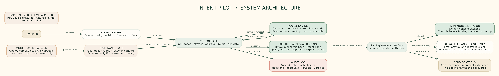

# IntentPay — Intent-Bound Purchase Agent

**Corporate cards that can only spend what a person approved.**

The agent reads vendor terms, a person approves the intent, and the card enforces it at the rail — wrong amount, currency or category declines with a named reason. Built on the Airwallex issuing API (Visa cards). Proven live on the Airwallex issuing sandbox.

The Visa-side modules are TAP-style RFC 9421 signature verification and a VIC-shaped instruction adapter with a fixture provider. No live Visa integration is claimed.

## The problem

A founder weighing a SaaS plan gets the same pitch every time: pay annually, save 18%. Whether that is a good deal depends on the cash forecast, not the discount. And even when someone makes the right call, nothing enforces it: the corporate card in someone's wallet will happily pay any amount, in any currency, in any merchant category. Agents that "remember the policy in the prompt" are worse — a prompt is a suggestion, not a control.

## What it does

The agent reads the vendor's terms, computes the annual-vs-monthly decision against the cash forecast and reserve floor in deterministic policy code, and asks a person to approve an **intent** (cadence, amount cap, currency, merchant categories). The card it then issues on Airwallex carries exactly those controls. Anything outside them declines at the card, with the policy rule as the decline reason.

Demo fixture data:

| Case | Policy decision | Why | Card issued |
|---|---|---|---|
| Acme Analytics Pro | Monthly | Annual saves 18% but breaches the $500 reserve floor in week 7 | Cap $100, USD only, software only |
| Flowdesk | Annual | Saves 16% and never breaches the floor | Cap $950, USD only, software only |

## How it works

1. **Extract.** Terms come from the vendor's pricing text (untrusted input) or from a model proposing an extraction under a governance gate.
2. **Decide.** `src/policy/policy.ts` computes the cadence: weekly balances, first week below the reserve floor, savings percent, reconsider date. Malformed inputs escalate to a person.
3. **Approve.** A person approves the intent in the console — an HMAC signature over the terms hash, intent hash, policy version, approver, expiry and nonce.
4. **Issue.** Card controls derive from the approved intent and nothing else. The approval is re-verified before issue, consumed once, and refused if the deal changed.
5. **Enforce.** Authorizations clear or decline inside the card's controls. The simulator and the live Airwallex gateway implement the same `IssuingGateway` interface. Control-plane mutations carry `request_id` with retry-stable payloads under the provider's documented idempotency contract - the control plane rejects an aliased request id reused with a different payload (observed 6 Oct); identical-payload replay dedupe is documented, not separately observed. The sandbox authorization simulator documents no request-id dedupe, so an uncertain authorization outcome stays locked for reconciliation rather than retried.

<p align="center"></p>

More diagrams — intent lifecycle, approval binding, the governance gate, the IRL user flow — in [docs/](docs/user-flow.md).

## The model layer (optional)

**The model proposes. The gate decides.** The model gets two typed tools: `read_terms` (read only) and `propose_terms` (a proposal, nothing more). There is no tool that approves, issues or charges anything. Vendor terms are wrapped in `<vendor_terms>` and treated as data — an instruction inside them cannot change the outcome.

Every proposal passes `gate()`: schema validation, no-new-facts guardrails, a weighted rubric where code does the arithmetic, and reasoning checks. A proposal is accepted only when it agrees with the deterministic policy decision, or when it asks for a person. Rejections change nothing and are audited. Details: [docs/model-governance.md](docs/model-governance.md).

Provider is config, not code:

- `ANTHROPIC_API_KEY` (+ optional `ANTHROPIC_MODEL`) — wins when set
- `EXTRACTION_BASE_URL` / `EXTRACTION_MODEL` / `EXTRACTION_API_KEY` — any OpenAI-compatible endpoint (local servers like Ollama take no key)
- Without any key, `POST /api/extract` answers 501 and the queue works as before

## Quickstart

```bash
git clone https://github.com/vyayasan/intent-pilot
cd intent-pilot
npm install
npm start
```

Open http://localhost:3000. Review a case, approve the intent, create the card, then try the purchases: the in-policy one clears; over-cap, wrong-currency and wrong-category ones decline with the rule they broke. Freeze the card and everything declines. The console binds to loopback only, checks Host and Origin, and uses a per-run token. With `AIRWALLEX_CLIENT_ID` and `AIRWALLEX_API_KEY` set it runs live against the Airwallex sandbox instead of the simulator.

`npm run demo` runs the whole story against the sandbox, deterministic and narrated for screen recording. Sandbox money only.

## Verify

```bash
npm test        # 481 tests
npm run evals   # 58 deterministic scenarios, writes evals/RESULTS.md
npm run smoke   # end-to-end flow in one process
npm run typecheck
```

- **481 automated tests** — policy math, intent hashing, bound approvals, the card state machine, simulated and live gateway mappings, TAP/webhook verification, the console, the governance gate, and cross-layer redteam attacks (stolen approvals, double-submits, CSRF, double-spend retries, illegal transitions).
- **58 deterministic eval scenarios** — policy boundaries, fail-closed inputs, card-control declines, scripted model proposals through the governance gate ([evals/RESULTS.md](evals/RESULTS.md)).

## Proven live

- **Agentic changed-deal E2E (2026-11-03, runtime tree `8190227`):** live Claude extracted a synthetic vendor offer and chose the execution tools after explicit operator approval. A $200 USD sandbox purchase cleared (`01a1a2c4-2ed4-7000-8ed9-49fbbb2194f7`). Changing the monthly price to $220 froze the old card (provider read-back INACTIVE); its next $200 attempt declined CARD_INACTIVE (`01a1a2c5-3582-7000-a02e-e6b913ec50d1`), and stale approval reuse returned 409. Fresh operator approval let the live agent issue a replacement and clear $220 (`01a1a2c5-95e1-7000-8921-838d281cb54b`). Exact IDs, provider controls and statuses were independently read back. Both agent runs ended `ok:true`, `needsReconcile:false`, with `ledger.state=ok`. Email transport was preview only: zero sends. Vendor offer and cash forecast were synthetic; the sandbox capture/ledger reports AIRPRO_TX_GENERATOR / MCC7531, not the requested vendor/MCC5734. The console retains that artifact rather than rewriting it. This is sandbox authorization/capture evidence, not settlement or live merchant acceptance. OIDC was disabled for this localhost demo-token run, so it does not prove the production sign-in path. Private evidence is held separately for judge access.

- **Airwallex issuing sandbox (2026-10-06):** real cardholder, virtual cards issued with controls mirroring approved intents, authorizations passing and failing with the sandbox's own decline reasons (`LIMIT_EXCEEDED`, `CURRENCY_NOT_ALLOWED`, `MERCHANT_CATEGORY_NOT_ALLOWED`, `CARD_INACTIVE`), freeze/unfreeze, captures CLEARING.
- **Live open-weights model (2026-10-06):** unscripted extraction runs through the governance gate — clean passes accepted, a policy override enforced (model proposed annual, the gate enforced monthly on the reserve floor), an injection attempt treated as data and surfaced, fabricated facts rejected.

- **Changed-deal proof, Airwallex sandbox (2026-10-21):** a person approved a $100/month intent; the issued card cleared a $100 in-policy purchase. The deal then changed to $90: the old approval was invalidated, the old card frozen (independent read-back INACTIVE), re-use of the stale approval refused with HTTP 409, and the previously allowed $100 purchase declined at the card with CARD_INACTIVE. A fresh $90 approval issued a new card and cleared $90. Every step receipted; card and transaction IDs reconcile against the sandbox dashboard. Receipts (audit extracts, response records, captures) are kept in the owner's private Drive, evidence file 1TOcFy0aY4WYbNkrYwCbmOhy2MPY7v35x. Harness: scripts/changed-deal-proof.ts (typed human confirmations, exclusive run folders, no automatic retry).

## Honest limits

- Policy and approval checks live in deterministic code. The extraction model proposes terms; the execution agent can issue a card and execute one purchase only after a valid approval, through audited typed tools. It cannot choose amounts or weaken card controls.
- The console supports authenticated sign-in (Google OIDC) with enrolled roles - approver, viewer, operator; unlisted users are denied by default - exercised as the approver session in the 27 Oct 2026 sandbox run. Approval signatures still come from a console-local ed25519 key (generated per install, persisted in the gitignored state file), and card creation verifies that signature, so a foreign or stripped approval is refused. The key proves local integrity (this install's key signed the approval), not by itself a human's identity: that binding comes from the authenticated session, and production binds approvals to SSO-managed identity.
- The simulator mirrors the sandbox semantics relied on here; one documented difference: the sandbox simulator authorization endpoint does not deduplicate request ids, the control plane does.
- Permanent card close is API-only (`POST /api/close-card`), deliberately not a console button: the ladder is ACTIVE -> FROZEN -> CLOSED, so no single request closes a transacting card. It refuses while an authorization outcome is unresolved, requires a verified freeze first, confirms by provider read-back (an unconfirmed close is `outcome_unknown` and stays locked for reconciliation), and audits `card_closed`. After a close, a fresh approval issues a replacement card.
- The Visa-side modules (TAP-style signature verification, VIC-shaped instruction adapter) run against fixtures. No live Visa integration is claimed.

## Email delivery (preview by default)

Each workflow step renders the exact email it would send (approval, card issued, cleared, declined, deal changed, outage) into a persisted outbox. **Nothing is sent by default.** A transport only runs when the operator selects one:

- `INTENTPAY_EMAIL_TRANSPORT` unset or `preview` (default): previews only, nothing is sent.
- `dry-run`: validates the full pipeline (recipient, subject/body, integrity hash) and records dry-run receipts. Still nothing is sent.
- `http`: EXPERIMENTAL - posts each record to `INTENTPAY_MAIL_ENDPOINT` (optional `INTENTPAY_MAIL_TOKEN`). Tested only against local fake servers; it has never run against a real email provider.
- `gmail`: sends through the Gmail API from an owner-approved Google account (OAuth refresh-token credentials via `INTENTPAY_GMAIL_CLIENT_ID` / `INTENTPAY_GMAIL_CLIENT_SECRET` / `INTENTPAY_GMAIL_REFRESH_TOKEN`). First real-provider use: the 27 Oct 2026 sandbox lifecycle run, which delivered exactly the two approved self-addressed notifications.
- Hard send boundary (optional): when the owner approves a specific send scope, `INTENTPAY_EMAIL_ALLOW_KINDS` / `INTENTPAY_EMAIL_ALLOW_TO` / `INTENTPAY_EMAIL_ALLOW_MAX` wrap the transport in an allowlist. Anything outside the approved kinds, recipient or count is withheld - a definite not-sent, recorded on the record and audited as `email_withheld`. An ambiguous outcome consumes the approved count, so retries can never exceed it.

Delivery is idempotent: a record that reached `sent`/`dry-run` is never sent again, even across restarts, and a `failed` delivery stays failed for operator review - the console never blindly resends.

Mode changes do not bridge themselves. A dry-run receipt is not a delivery, and selecting a real transport later does not fire the dry-run records: the only bridge is explicit operator promotion (`POST /api/notifications/promote` with `INTENTPAY_OPERATOR_TOKEN`), which is written to the audit log and stamped on the receipt.

Failures are classified like the payment rail. Only failures provably before the request left this process (refused connection, DNS, blocklisted port, local validation) are DEFINITE not-sent. Once the request has arrived, no HTTP status alone proves non-delivery - a side effect can precede the answer - so a bare 4xx or 5xx, a timeout or a dropped connection stays AMBIGUOUS and is never auto-resent. The single definite post-arrival rejection is the documented contract: a JSON body `{"rejected": true, "reason": "..."}`.

Real provider accounts, recipients and wording are a separate owner-approved decision each time. The `gmail` transport is an implemented product transport, first used against the real provider in the 27 Oct 2026 sandbox run under a two-send self-addressed allowlist. The `http` seam remains tested only against local fake servers.

## Layout

    src/policy      the cadence decision and the card payload
    src/intent      intent hashing
    src/approval    HMAC-bound approvals, approver-key signatures
    src/notify      email outbox, transport seam, delivery dispatcher
    src/gateway     Airwallex client, live gateway, webhook verification
    src/sim         the simulated issuing gateway
    src/visa        TAP-style signature verification, VIC-shaped fixture adapter
    src/agent       model client, planner, rubric, guardrails, reasoning checks
    src/console     the review console (loopback only)
    docs            architecture and governance diagrams (.dot + render.sh), user flow
    evals           deterministic policy, simulation and governance scenarios
    scripts         live-run harnesses and the smoke test
    test            unit, gateway and cross-layer redteam suites

Built fast with AI pair-programming and reviewed by hand. MIT licensed. Copyright (c) 2026 Sandi Samantaray.
