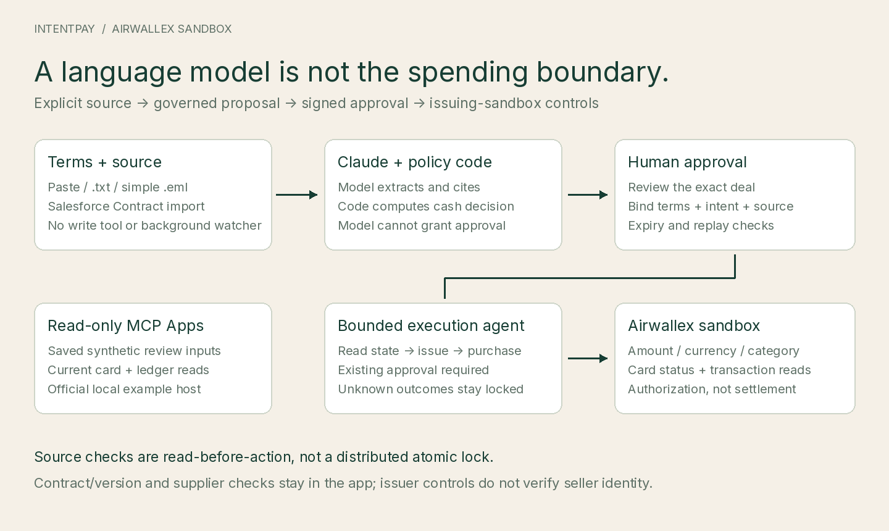

# Architecture

## Code is the spending boundary

The model extracts language and selects from bounded execution tools. Deterministic policy calculates the cash decision. Approval binds the exact terms and intent before the card payload is derived. The model cannot grant approval or rewrite controls.

| Concern | Implementation |
| --- | --- |
| Terms / notice / Salesforce intake | `src/intake/` |
| Cash comparison and card payload | `src/policy/` |
| Intent hash and approval binding | `src/intent/`, `src/approval/` |
| Extraction governance and execution loop | `src/agent/` |
| Airwallex sandbox / local simulator | `src/gateway/`, `src/sim/` |
| Console and lifecycle API | `src/console/` |
| Application notice previews and allowlisted transports | `src/notify/` |
| Read-only MCP Apps review | `mcp/` |

## What binds an approval

Terms and intent hashes, policy version, approver, expiry and nonce are checked before use. Approval integrity uses the local persisted signing key as well as the approval envelope. Human identity comes from authenticated session/role configuration, not from a signature alone. Approval consumption and state transitions prevent replay.

## Source guard

The Salesforce fingerprint includes record ID, SystemModstamp, status, account label and SpecialTerms. Approval, issuance, agent launch and direct purchase re-read the source. A mismatch or failed read blocks old authority. Explicit refresh invalidates the previous review, verifies any freeze and starts a distinct unapproved case. Manual edits and uploaded notices cannot bypass a bound source.

This is not atomic with remote authorization and there is no background watcher. See [Salesforce boundaries](salesforce-contract-source.md).

## Issuer controls versus application checks

Airwallex enforces amount, currency and merchant-category restrictions. Vendor identity, terms hashes and source version are application checks. The sandbox generator's transaction merchant/category differs from the scenario label; it does not establish a real seller binding.

Only a documented failed/declined provider result is a rejection. A lost or unknown authorization response stays locked pending reconciliation rather than being reissued. Control-plane operations use retry-stable request IDs; the sandbox authorization simulator does not provide the same dedupe guarantee.

## MCP review

The separate prototype packages the review UI as an MCP Apps resource. `show_review` combines saved synthetic inputs/prior result with current sandbox card/ledger reads. The local official example host is tested, other hosts are not. No financial action tools are registered.

## Supporting design notes

- [Model governance](model-governance.md)
- [Approval binding diagram](3-approval-binding.png)
- [Recovery](RECOVERY.md)
- [Production considerations](PRODUCTION.md)
